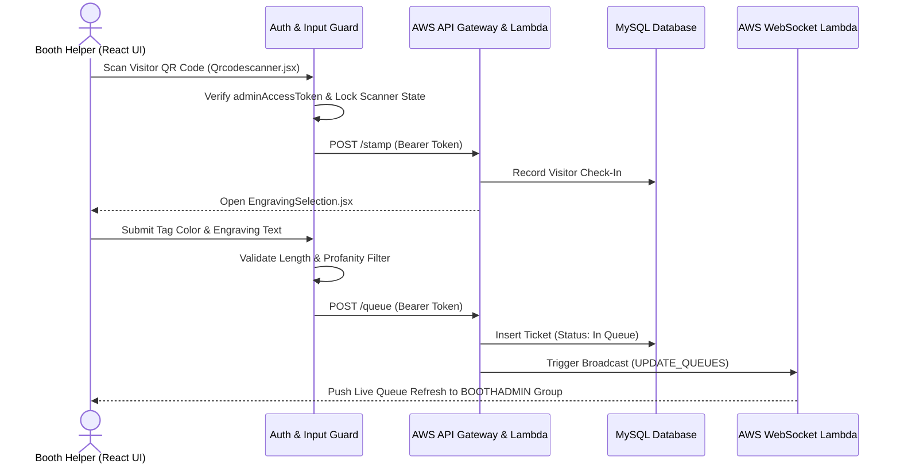
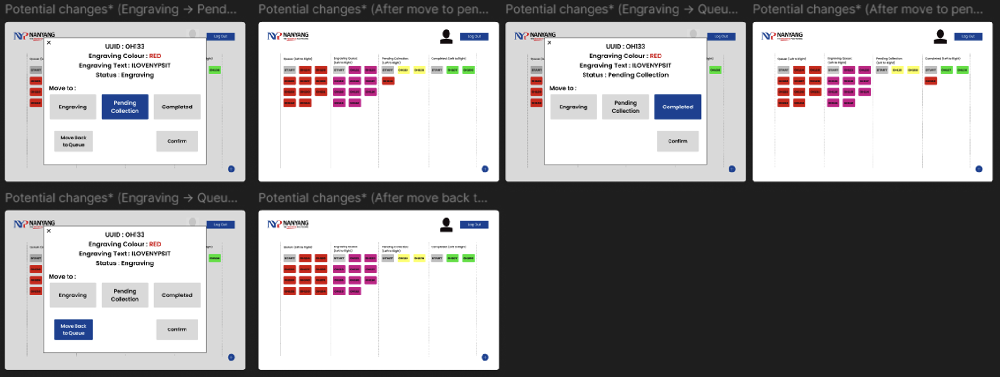
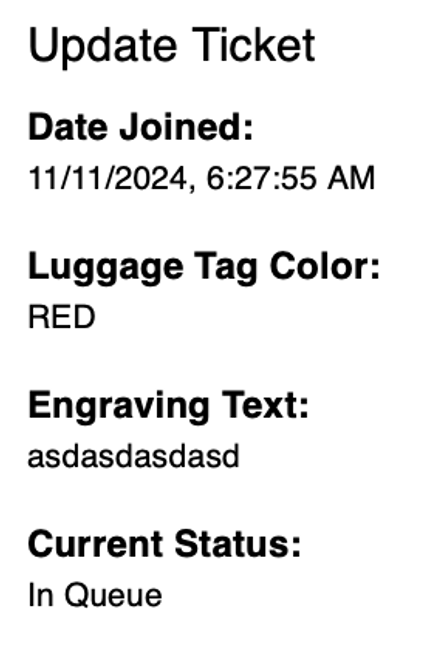
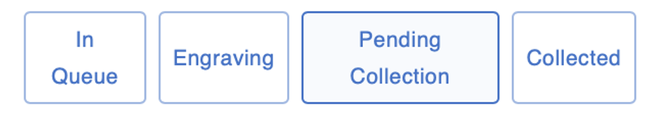
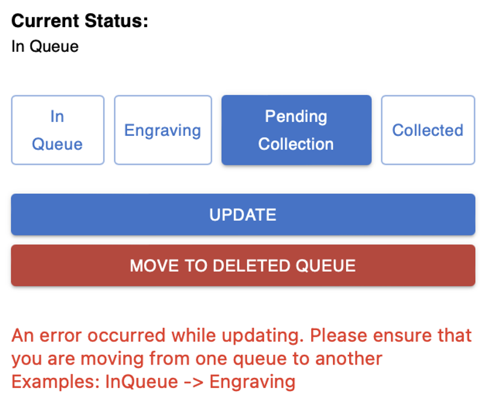

# Open House Digital Queue & Engraving Management System

A full-stack, mobile-friendly event operations web application built with **React JS**, **Node.js**, **MySQL**, and **AWS Serverless (API Gateway, Lambda, and WebSockets)**. Designed for campus Open House booths to streamline visitor QR code scanning, custom luggage tag engraving orders, and real-time multi-stage queue synchronization across admin devices.

---

## Real-Time System Architecture

---

## Core Engineering & Security Features

* **Authentication & Route Protection (`Qrcodescanner.jsx`, `EngravingSelection.jsx`):** Guards admin routes by verifying `adminAccessToken` presence and attaching `Bearer` authorization headers to outbound AWS API requests, redirecting unauthenticated sessions to `/adminlogin`.
* **Input Validation & Content Filtering (`EngravingSelection.jsx`, `AdminQueue.jsx`):** Enforces regex-based profanity filtering, character limits, and strict queue-status allowlist checks (`validateQueueStatus`) to prevent invalid state transitions.
* **Race-Condition Prevention (`Qrcodescanner.jsx`):** Uses scan-locking state flags (`scanningInProgress`) and clean camera lifecycle resets (`qrScannerRef.current.stop()`) to prevent duplicate API submissions during rapid booth scanning.
* **Real-Time Multi-Stage Queueing (`WebSocket Lambda`):** Listens for `UPDATE_QUEUES` WebSocket events under the `BOOTHADMIN` group to automatically synchronize ticket movements (*In Queue -> Engraving -> Pending Collection -> Collected*) across all active tablets without manual page refreshes.
* **Operational Reporting:** Includes live ticket search filtering, "Today / All" view toggles for collected items, and one-click CSV data export.

---

## Visual Proof & Wireframes

### 1. Figma Wireframes vs. Production Queue Interface

### 2. Multi-Stage Queue Controls & Validation Prompts

